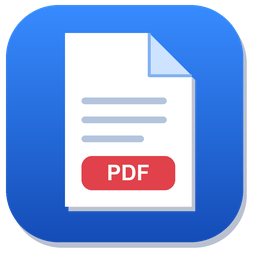

<div align="center">
  
  <h1>QudoPDF</h1>
  <p>A private, offline PDF toolkit for Windows.</p>
  <p>
    <a href="#english">English</a> · <a href="#中文">简体中文</a> ·
    <a href="https://www.qudo.cc">qudo.cc</a>
  </p>
  <p>
    
    
    <a href="LICENSE"></a>
  </p>
</div>

QudoPDF is a desktop PDF reader and editor built with **PySide6** and **PyMuPDF**. It brings common page operations, annotations, watermarking, signing, content editing and file conversion into one app. Documents are processed locally; the app does not upload them to a server.

**Contact:** [www.qudo.cc](https://www.qudo.cc) · [xuejiazhi@gmail.com](mailto:xuejiazhi@gmail.com)

## English

### Features

- **Read and organize:** continuous scrolling, bookmarks, page thumbnails, multi-page selection, merge, split, reorder, rotate, crop and remove white margins.
- **Edit and review:** edit or move page text and images, add text and image watermarks, page numbers, annotations, and signatures; permanently redact selected content.
- **Convert and extract:** export to Word or Excel, convert pages to images, extract text and images, and inspect or remove document metadata.
- **Protect and optimize:** compress PDFs, set passwords and permissions, and remove passwords from authorized files.
- **Work comfortably:** undo and redo, recent-file history, drag-and-drop opening, right-click “Open with,” and Chinese/English interface.

### Quick start

Download a Windows build from the project's Releases page, or run from source:

```bash
python -m pip install -r requirements.txt
python run.py
```

You can open a PDF directly from the command line:

```bash
python run.py path/to/document.pdf
```

Requires Python 3.10 or newer. The application is developed and packaged on Windows 10/11.

### Build

```bash
python -m pip install -r requirements.txt
python -m pip install pyinstaller
python -m PyInstaller QudoPDF.spec --noconfirm
```

The executable is written to `dist/QudoPDF.exe`.

### Development checks

```bash
python _test_engines.py
python _smoke.py
python _e2e.py
```

### Project structure

```text
run.py                  Application entry point
QudoPDF.spec            PyInstaller build configuration
requirements.txt        Python dependencies
pdf_toolbox/core/       PDF document model and processing operations
pdf_toolbox/ui/         Main window, viewer, panels and dialogs
```

### Limitations

- Scanned pages need OCR before their text can be searched or exported as editable text.
- Editable Word export reflows the page and may change the original layout. Choose the image-based layout-preserving mode when visual fidelity matters more than editing.
- Replacing text may change glyph appearance when the original PDF uses embedded fonts. Existing vector shapes are not yet movable as whole objects.

### License

QudoPDF is licensed under [AGPL-3.0](LICENSE). Review the license terms of bundled dependencies when redistributing the application.

## 中文

QudoPDF 是一款面向 Windows 的离线 PDF 阅读与编辑工具，基于 **PySide6** 和 **PyMuPDF**。它把常用的页面处理、批注、水印、签名、内容编辑与格式转换整合在一个桌面应用中。文件在本机处理，不会上传到服务器。

**作者：**[www.qudo.cc](https://www.qudo.cc) · [xuejiazhi@gmail.com](mailto:xuejiazhi@gmail.com)

### 功能

- **阅读与页面管理：**连续滚动、书签目录、页面缩略图、多页选择、合并、拆分、排序、旋转、裁剪和去白边。
- **编辑与审阅：**修改或移动页面文字与图片，添加文字/图片水印、页码、批注和签名；永久涂销选定内容。
- **转换与提取：**导出 Word 或 Excel、转换为图片、提取文字和图片、查看或清除文档元数据。
- **保护与优化：**压缩 PDF、设置打开密码和权限、解除有权处理的文件密码。
- **便捷操作：**撤销/重做、最近打开记录、拖放打开、右键“打开方式”，以及中英文界面切换。

### 快速开始

从项目 Releases 下载 Windows 版本，或从源码运行：

```bash
python -m pip install -r requirements.txt
python run.py
```

也可以在命令行中直接打开 PDF：

```bash
python run.py path/to/document.pdf
```

需要 Python 3.10 或更新版本。应用目前在 Windows 10/11 上开发和打包。

### 打包

```bash
python -m pip install -r requirements.txt
python -m pip install pyinstaller
python -m PyInstaller QudoPDF.spec --noconfirm
```

生成的程序位于 `dist/QudoPDF.exe`。

### 开发检查

```bash
python _test_engines.py
python _smoke.py
python _e2e.py
```

### 项目结构

```text
run.py                  应用入口
QudoPDF.spec            PyInstaller 打包配置
requirements.txt        Python 依赖
pdf_toolbox/core/       PDF 文档模型与处理逻辑
pdf_toolbox/ui/         主窗口、查看器、面板与对话框
```

### 已知限制

- 扫描版页面需要先做 OCR，才能搜索或导出为可编辑文字。
- 可编辑 Word 导出会重新排版，版式可能与 PDF 不同；需要尽量保留外观时，请使用基于整页图片的版式还原模式。
- 替换文字时，如果 PDF 使用了嵌入字体，字形外观可能变化；目前不能把已有矢量图形作为整体移动。

### 许可

QudoPDF 使用 [AGPL-3.0](LICENSE) 许可。重新分发程序时，也请核对所包含依赖各自的许可条款。
